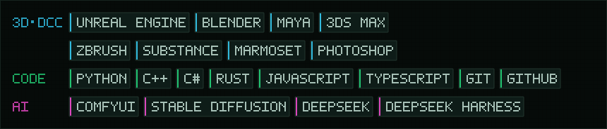
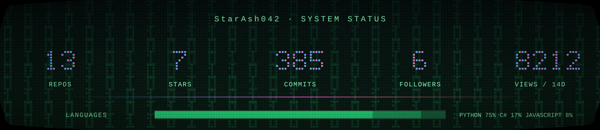

## 🎮 About Me

<table>
<tr><td><b>name</b></td><td>StarAsh042</td></tr>
<tr><td><b>role</b></td><td>Game Scene Modeler / 3D Artist</td></tr>
<tr><td><b>company</b></td><td>Keywords Studios</td></tr>
<tr><td><b>location</b></td><td>Chengdu · Sichuan · China</td></tr>
<tr><td><b>focus</b></td><td>Game Engines · AIGC · 3D Toolchain Automation · Vibe Coding</td></tr>
<tr><td><b>motto</b></td><td>"42 reboots, still StarAsh."</td></tr>
</table>

- 🎨 **场景建模** —— 游戏场景与道具，从 blockout 到最终资产
- 🧩 **插件开发** —— Blender + Python，把重复流程做成一键工具
- 🛠️ **流程自动化** —— 重拓扑 · 低模质检 · 顶点色 · 批量渲染
- 🧠 **技术探索** —— 游戏引擎与 AIGC，寻找 AI × 3D 的接缝
- ⚡ **Vibe Coding** —— 随手写些小工具，先解决自己的痒点
- 🌱 **持续学习** —— 保持好奇，欢迎交流建模与工具开发

## 🧰 Tech & Tools

## 📊 Stats

## 📫 Connect with Me

  

